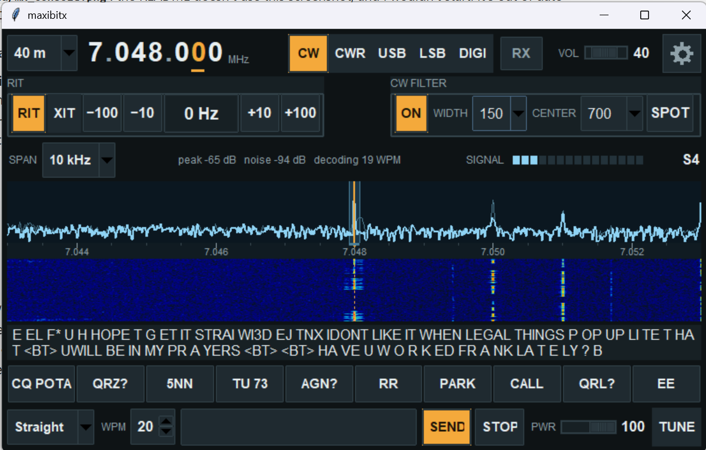

# maxibitx

A headless, all-mode (CW, USB, LSB, DIGITAL) radio daemon for the
Raspberry Pi inside an [sBitx](https://github.com/afarhan/sbitx). It
brings up the radio hardware, runs the receive and transmit signal
chains, and serves external software. There's no user interface in
the process: SDR apps, WSJT-X and FLRig provide the display and
controls, over the network or USB.

A small separate control panel, `tools/rigctl_panel.py`, runs on the
Pi's own screen or on another machine on the network.



## Where it came from

**sbitx** is Ashhar Farhan's (VU2ESE) software for his radio. His software was forked
to https://github.com/drexjj/sbitx/tree/main and greatly refined and extended.  **sbitx**
gained many new features, and the codebase and file size have grown. `sbitx.c` and `sbitx_gtk.c`
alone are more than 3,000 and 12,000 lines respectively, with the GTK user interface, DSP and
hardware initialization and control intertwined. 

**minibitx** asked how little code it takes to run the sBitx hardware
well. It pulled out only what the hardware needs and refined each
piece. wiringPi gave way to the kernel's GPIO character device,
bit-banged I2C to the kernel's I2C driver, and the rest of the DSP and
all of the UI were left to mature external SDR apps.

**maxibitx** started from minibitx's hardware and control layer and adds
an all-mode transmitter pipeline and an onboard demodulator - without
bringing the coupling back. Every job lives in its own small file,
and no UI runs in the process. Anything an external display or controller needs
goes through a narrow, documented interface
([`docs/06_api.md`](docs/06_api.md)).

The whole daemon is about 14,000 lines of C in 36 files; a big part of
that is in a collection of external interfaces, which provide a variety
of ways to connect applications to maxibitx.
[`docs/00_intro.md` §3](docs/00_intro.md#3-the-code) maps every file to
the job it does.

## Features & Capabilities

### Hardware & Architecture
- **Multi-board support:** Runs natively on **sBitx** (DE, v2, v3) and **zBitx** hardware from a single codebase, configured via `data/hw_settings.ini`.
- **Modular headless architecture:** Separates real-time DSP and hardware control from the UI so display or control changes stay cleanly isolated.
- **Native Linux kernel I/O:** Uses Linux kernel GPIO character devices and native I2C drivers for clean, deterministic hardware control.

### Receive & Transmit DSP
- **All-mode transceiver pipeline:** Full support for **CW**, **USB**, **LSB**, and **DIGITAL** modes across all nine HF bands (80m–10m).
- **Refined CW keying:** Supports straight keys, bugs and iambic paddles with proper element weighting, clean envelope shaping, no dropped leading/trailing elements, and per-band power calibration.
- **Clean CW keying:** a 9 ms ramp at every speed, shaped to ARRL's Clean Signal Initiative mask; on the bench the radio's own keying passes it at 40 WPM, at full and reduced power (`make test-cw-shape`, [`tx_cw_keying_spectrum.md`](docs/dsp_design_notes/tx_cw_keying_spectrum.md)).
- **On frequency:** the si5351's reference and the codec's sample rate are each calibrated (`cal`, `codec_rate`); WWV reads within 1 Hz from 10 to 20 MHz, and transmit lands on the dial ([frequency calibration](docs/dsp_design_notes/tx_test_tones_and_alc.md#frequency-calibration-the-si5351-reference-and-the-codecs-rate)).
- **Timing-adaptive CW decoding:** Timing-based decoder that adapts to character/element timing variations and shifting signal conditions.
- **Onboard demodulation & filtering:** Dedicated CW, USB, and LSB demodulators drive the speaker directly alongside audio routing for digital mode software.
- **Verified voice & digital operation:** Proven on-air with SSB voice and two-way FT8 contacts via WSJT-X over the USB audio gadget.

### External Interfaces & Control
- **HPSDR Protocol 1:** Streams wideband baseband I/Q over UDP to desktop SDR clients such as **SDR Console** and **SparkSDR**.
- **Transceiver Control Interface (TCI):** Built-in WebSocket server (port `50001`) carrying rig control, bidirectional audio, I/Q streams, and CW text over one connection for **sdrOxide**, **JTDX**, **WSJT-X Improved**, loggers, and Hamlib's TCI backend.
- **Hamlib & Kenwood CAT:** Network rig control via `rigctld`-compatible TCP (port `4532`) plus Kenwood TS-480 CAT emulation over USB serial.
- **USB Audio & Serial Gadget:** Presents the radio as a standard USB sound card and serial port to a host computer for single-cable digital operation.
- **Standalone Touch Control Panel:** Includes `tools/rigctl_panel.py`, a lightweight external GUI offering tuning, mode/filter selection, volume/mic gain, and a live spectrum and waterfall display.

### Built-in Verification
- **Hardware-free bench suite:** `make test` builds and runs 22 bench tests and says which, if any, failed: the receive and transmit DSP chains, CW keying and its spectrum, the keyer, the CW decoder, the si5351's frequency arithmetic, the TCI server over loopback, and the radio and board layers with GPIO and I2C stubbed. No radio needs to be attached.
- **Measure your own radio:** tools that characterise the hardware through the radio itself: [`xtal_sweep.py`](tools/README.md#xtal_sweeppy) (the 40 MHz crystal filter), [`lpf_sweep.py`](tools/README.md#lpf_sweeppy) (the band low-pass filters), [`spur_survey.py`](tools/README.md#spur_surveypy) (the receiver's own spurs), [`cw_shape.py`](tools/README.md#cw_shapepy) (a CW signal's keying against the Clean Signal Initiative mask) and [`capture_check.py`](tools/README.md#capture_checkpy) (the codec's raw captures). Results from one sBitx: [`sbitx_filter_measurements.md`](docs/dsp_design_notes/sbitx_filter_measurements.md).

## Building and running

```
make
./maxibitx
```

`data/hw_settings.ini` must name the radio board, on a line above its
first `[section]`: `sbitx_version = SBITX_V3` for an sBitx DE, v2 or
v3, or `sbitx_version = SBITX_V4` for a zBitx.
Without it maxibitx prints the valid lines and exits, before touching
any hardware. Run it from the repository root, where it finds
`data/hw_settings.ini`.

Needs `libasound` and single-precision FFTW (`libfftw3f`); see
`Makefile`. `make` also grants the binary real-time scheduling and the
permission the USB gadget needs (`setcap`). `make test` builds and runs
every bench test. `./update` stashes local changes and pulls the latest;
then `make` again.

The Pi needs the codec's overlay (`dtoverlay=audioinjector-wm8731-audio`),
the si5351's I2C bus (on an sBitx, the `i2c-rtc-gpio` overlay it shares
with the RTC), and the user in the `gpio` group; see
[`docs/01_hardware_init_and_control.md`](docs/01_hardware_init_and_control.md).
A zBitx also needs the UART off
([`docs/08_troubleshooting_and_bringup.md`](docs/08_troubleshooting_and_bringup.md)).
The USB gadget needs a device-mode USB port and a few kernel options:
[`docs/dsp_design_notes/usb_gadget_OS_setup.md`](docs/dsp_design_notes/usb_gadget_OS_setup.md).

## Documentation

| Doc | Content |
|---|---|
| [`docs/00_intro.md`](docs/00_intro.md) | Introduction to maxibitx: the whole system in one stand-alone document, including the RX and TX pipelines in detail |
| [`docs/ARCHITECTURE.md`](docs/ARCHITECTURE.md) | Design rationale and build order, step by step, with measurements |
| [`docs/01_hardware_init_and_control.md`](docs/01_hardware_init_and_control.md) | GPIO, si5351/I2C, WM8731 codec bring-up |
| [`docs/02_rx_processing_pipeline.md`](docs/02_rx_processing_pipeline.md) | Antenna to I/Q and audio, stage by stage |
| [`docs/03_tx_processing_pipeline.md`](docs/03_tx_processing_pipeline.md) | Audio source to antenna: keying/PTT, `tx_pipeline.c`, power, known limitations |
| [`docs/04_remote_control_and_iq_output.md`](docs/04_remote_control_and_iq_output.md) | How the external interfaces are implemented |
| [`docs/05_process_and_threading_model.md`](docs/05_process_and_threading_model.md) | Startup sequence, threads, and a map for reading `sound.c` |
| [`docs/06_api.md`](docs/06_api.md) | The external interfaces - rigctld, I/Q streams, USB audio and CAT, TCI - for building an app on maxibitx, plus WSJT-X setup |
| [`docs/08_troubleshooting_and_bringup.md`](docs/08_troubleshooting_and_bringup.md) | Hardware bring-up gotchas |
| [`docs/09_faq.md`](docs/09_faq.md) | Common questions: where it came from, why the design is the way it is, ALC, the interfaces, what's not done |
| [`docs/dsp_design_notes/`](docs/dsp_design_notes/) | Measurements, derivations and debugging history for the DSP |
| [`docs/code_comments.md`](docs/code_comments.md) | Comment policy: code says what's true now, docs say how it got there |

## Credits

- Ashhar Farhan (VU2ESE) - the sBitx radio and its original software
- Jesse Kujawa (W9JES) - the 64-bit sbitx repository,
  https://github.com/drexjj/sbitx, which the code was based on
- `hpsdrsim.c` protocol details from the piHPSDR project
- [minibitx](https://github.com/MikeJohnshoy/minibitx), maxibitx's direct
  predecessor
- Evan Hand (AC9TU), Robert Benedict (KD8CGH) and Juan Agrinsoni (WP3DN) - encouragement
  throughout

## License

GNU General Public License v3.0, to the extent that it does not violate
the rights of the authors whose open-source code this was drawn from -
see [`LICENSE`](LICENSE) and
[`docs/00_intro.md`](docs/00_intro.md#10-licensing-and-acknowledgements).
