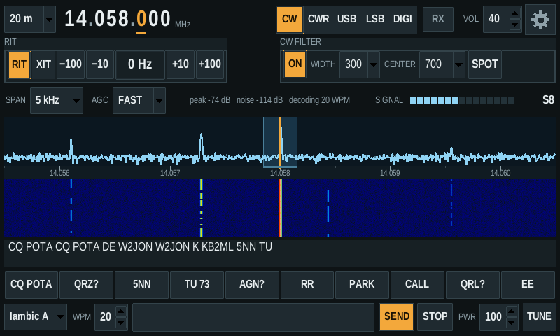
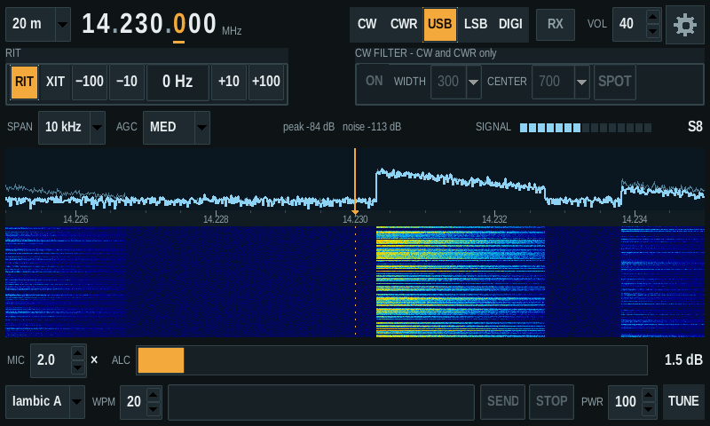

# 01 — user manual

**Status: first draft.** Places that need a test on the radio, a
setting checked on air, or a decision are marked
**[TO BE COMPLETED]**, with what is needed.

This manual is for operating maxibitx: getting it running, using the
control panel, and working CW, SSB and the digital modes. It says what
to do and what you will see, not how it works inside. For that, each
section links to [`00_intro.md`](00_intro.md); for writing software
against the radio, see [`06_api.md`](06_api.md); for bring-up
problems in depth, [`08_troubleshooting_and_bringup.md`](08_troubleshooting_and_bringup.md).

The screenshots show the control panel at the sBitx screen's 800×480,
connected to a simulated radio, so the band activity in them is made
up.

**Contents**

1. [Before you start](#1-before-you-start)
2. [Installing](#2-installing)
3. [Starting and stopping](#3-starting-and-stopping)
4. [The control panel](#4-the-control-panel)
5. [Operating CW](#5-operating-cw)
6. [Operating SSB](#6-operating-ssb)
7. [Digital modes](#7-digital-modes)
8. [SDR programs and remote operation](#8-sdr-programs-and-remote-operation)
9. [Setting up your radio](#9-setting-up-your-radio)
10. [Reference](#10-reference)
11. [When something's wrong](#11-when-somethings-wrong)
12. [What it doesn't do (yet)](#12-what-it-doesnt-do-yet)

---

## 1. Before you start

### What you need

- An **sBitx** (DE, v2 or v3) or a **zBitx**, with its Raspberry Pi.
  On the sBitx that is a Pi 4 behind the 7-inch screen; on the zBitx, a
  Pi Zero 2W.
- For CW, a **straight key or paddles** in the key jack. For SSB on the
  sBitx, the **microphone**. The zBitx has no microphone SSB in
  maxibitx yet.
- An **antenna**, and a **dummy load** for the first transmissions and
  for calibrating power.
- For digital modes, a **computer** running WSJT-X, JTDX or similar,
  connected by USB or over the network.
- Optionally, a **wattmeter**. A tuner's built-in meter will do, with
  the caveats in [§9](#9-setting-up-your-radio).

### What maxibitx is

maxibitx is the software that runs the radio. It brings up the
hardware, turns the antenna's signals into audio and a spectrum, and
turns your key, mic or computer audio into RF. It has no screen of its
own. Its front panels are separate programs that connect to it, on the
Pi itself or from another computer on your network:

| Front panel | Use it for | Connects by |
|---|---|---|
| The maxibitx control panel (`tools/rigctl_panel.py`) | Everyday operating, CW above all: tuning, filters, keyer, macros, spectrum and waterfall | the network (rigctld and the I/Q stream); runs on the Pi's screen or any computer |
| WSJT-X, JTDX, FLDigi | FT8, FT4 and other digital modes | USB cable (audio + CAT), or TCI over the network |
| SparkSDR, SDR Console | A big panadapter on a desktop | HPSDR over the network |
| sdrOxide | A panadapter | TCI over the network |
| FLRig, loggers | Rig control alongside other programs | USB CAT, rigctld or TCI |

Several can be connected at once: for example the panel on the Pi's
screen, WSJT-X over USB and a logger over the network. A change made in
one shows in the others the next time they look (TCI clients are told
within 50 ms; the panel polls several times a second).

### Before you transmit

- **maxibitx only transmits inside the bands listed in your
  `hw_settings.ini`** (its `[tx_band]` sections). Anywhere else, PTT is
  refused and the console says why. Those ranges are band edges, not
  your licence: staying inside your own privileges is up to you.
- The per-band power settings that come with maxibitx were calibrated
  on one particular radio. Check yours into a dummy load before going
  on the air ([§9](#9-setting-up-your-radio)).
- The radio has **no password**. Anyone who can reach it on your
  network can tune it and key it. Keep it on a network you trust.

---

## 2. Installing

### Prepare the Pi

maxibitx runs on Raspberry Pi OS. **A Pi already set up for the
mainstream sBitx software (jeSDR) has everything below except the
build libraries**, and maxibitx can be installed beside it
([below](#alongside-jesdr)). On a fresh install, the Pi needs:

- **The codec's overlay**, so the WM8731 audio codec appears as a sound
  card: `dtoverlay=audioinjector-wm8731-audio` in
  `/boot/firmware/config.txt`. Other sound cards (HDMI, the headphone
  jack) can stay: maxibitx finds the codec by its name,
  `audioinjectorpi`, whatever number it gets.
- **The si5351's I2C bus.** On an sBitx that is the `i2c-rtc-gpio`
  overlay it shares with the clock chip (it shows up as bus 22). On a
  zBitx it is bus 3.
- **SPI off on an sBitx.** The volume knob and two of the band filters
  use SPI0's pins.
- **The serial console and UART off on a zBitx.** Its receive line
  shares the UART's pin.
- **Your user in the `gpio` group** (the default `pi` user already is).
- **The build tools and libraries:**

  ```
  sudo apt install git build-essential libasound2-dev libfftw3-dev
  ```

  Optional, for checking hardware by hand: `i2c-tools gpiod`.

**[TO BE COMPLETED: the exact `config.txt` lines for a fresh Raspberry
Pi OS install on each board, without jeSDR.]**

### Alongside jeSDR

maxibitx can live on the same Pi as jeSDR, the mainstream sBitx
software, as a second choice: install it as below, in its own folder.
The two **can't run at the same time**: both use the same GPIO lines,
clock chip and sound card. Quit jeSDR before starting maxibitx, and
quit maxibitx before starting jeSDR. If jeSDR is still running,
maxibitx stops at start-up with `Device or resource busy` and
`init: GPIO setup failed`.

**[TO BE COMPLETED: how jeSDR starts at boot on its image, how to turn
that off while using maxibitx, and how to switch back.]**

### Get the code and build it

```
cd ~
git clone https://github.com/MikeJohnshoy/maxibitx.git
cd maxibitx
make
make test
```

- Keep it in `~/maxibitx`: the `./update` script expects it there.
- `make` asks for your password once, to give the program permission
  to run its audio at real-time priority and to set up the USB gadget
  without running as root.
- `make test` runs the bench tests (no radio involved) and ends by
  saying which, if any, failed. All should pass.
- Build on the Pi you will run it on. The build is tuned to that Pi's
  processor, so don't copy the program to a different Pi model.

### Make your settings file

maxibitx reads `data/hw_settings.ini` when it starts. Two starting
points come with it, one per board:

```
cp data/hw_settings_sbitx.ini data/hw_settings.ini     # an sBitx
cp data/hw_settings_zbitx.ini data/hw_settings.ini     # a zBitx
```

Then check the **board line** near the top. Exactly one of these must
be there, not commented out, above the first `[section]`:

```
sbitx_version = SBITX_V3     # sBitx DE, v2 or v3
sbitx_version = SBITX_V4     # zBitx
```

Without it maxibitx refuses to start, before touching any hardware: on
the wrong board it could switch the wrong lines.

For now leave the rest as it is. [§9](#9-setting-up-your-radio) covers
calibrating frequency and power for your own radio, and
[§10](#every-hw_settingsini-line) lists every line.

### Updating later

```
cd ~/maxibitx
./update
make
```

`./update` puts aside any changes you made to the repository's own
files (with `git stash`) and pulls the latest code. Your
`data/hw_settings.ini` isn't one of the repository's files, so it is
left as it is. New settings that later versions add are described in
the shipped `hw_settings_sbitx.ini` and `hw_settings_zbitx.ini`;
compare yours with them after an update.

### The USB gadget (optional)

For single-cable digital operation, the Pi 4's USB-C port can appear to
a computer as a USB sound card plus a serial port for CAT. You don't
need it for the control panel, for SDR programs, or for digital modes
over TCI. Without it, maxibitx starts normally and says:

```
uac: cannot create gadget root /sys/kernel/config/usb_gadget/sbitx_iq: No such file or directory
init: USB gadget unavailable, continuing without it
```

To turn it on, three one-time changes, then a reboot:

1. In `/boot/firmware/config.txt`, add a line:

   ```
   dtoverlay=dwc2,dr_mode=peripheral
   ```

2. In `/boot/firmware/cmdline.txt`, add ` modules-load=dwc2` to the end
   of the line. That file must stay **one line**: add it with a space,
   not on a new line.
3. Create `/etc/modules-load.d/maxibitx-usb-gadget.conf` containing the
   one line `libcomposite`:

   ```
   echo libcomposite | sudo tee /etc/modules-load.d/maxibitx-usb-gadget.conf
   ```

After the reboot, check before starting maxibitx:

```
ls /sys/kernel/config/usb_gadget/     # no error (an empty listing is right)
ls /sys/class/udc/                    # one entry, such as fe980000.usb
```

Then maxibitx's start-up shows the gadget instead of the lines above:
`init: USB gadget bound to UDC 'fe980000.usb' (UAC2 audio + ACM CAT)`,
the sound device `sBitx Audio` opened both ways, and the CAT port. Plug
a USB cable from the Pi's USB-C port to the computer: it appears as
"sBitx Audio" and a new serial (COM) port.

- **Power.** Once the USB-C port is a gadget, it no longer powers the
  Pi; the Pi must be powered some other way.
  **[TO BE COMPLETED: confirm the sBitx powers its Pi through the GPIO
  header, so nothing else is needed.]**
- **The other USB ports** (the Pi 4's USB-A ports) are unaffected and
  stay host ports for a keyboard, mouse or memory stick.
- **Alongside jeSDR**, the change only affects the USB-C port.
  **[TO BE COMPLETED: confirm jeSDR still runs normally after it.]**

The details, and what to do when Windows doesn't recognise the device,
are in [`usb_gadget_OS_setup.md`](dsp_design_notes/usb_gadget_OS_setup.md)
§3 to §5 and §10.

---

## 3. Starting and stopping

### Starting maxibitx from a console

Open a terminal on the Pi, or log in over SSH, and start it from the
repository folder:

```
cd ~/maxibitx
./maxibitx
```

It must start there: it looks for `data/hw_settings.ini` relative to
the folder it was started from.

As it starts, it prints one line for each step. On a healthy start you
will see, in this order:

1. **The settings it read**, each with its value: the board,
   `bfo_freq`, `xtal_filter_center`, power, `cal`, `codec_rate`, and
   `9 TX band scale entries loaded`.
2. **The board and its hardware**: `init: radio board: sBitx (DE, v2
   or v3)`, the codec's sound card (`sound: codec is card N
   ('audioinjectorpi')`; any number is fine), the GPIO lines parked in
   receive, the si5351 found on its I2C bus.
3. **Receive and the key**: tuned to 7.030 MHz, the key's two lines, the
   keyer (`keyer straight, 20 WPM`), and the start-up mode, DIGITAL.
4. **The interfaces**: rigctld on TCP 4532, TCI on 50001, HPSDR on UDP
   1024, the I/Q stream on UDP 4536, the USB gadget and its CAT port.
5. **The audio**: the codec configured, capture and playback opened at
   96000 Hz, audio running.
6. **The codec check**: `codec: sampling clean (...)`.
7. **The ready line**:
   `maxiBitx: radio hardware initialization complete, ready to serve!`

A few lines can appear on a healthy start and need no action:
`INA260 power monitor not responding, continuing without it` (it isn't
read yet anyway); `uac: gadget still bound ... from a previous run -
unbinding first`; and on a Pi without the USB gadget set up, lines
saying the gadget is unavailable.

**[TO BE COMPLETED: paste a current start-up from your sBitx here, as a
code block, to replace the list above or sit beside it.]**

Once it is running, the console shows **what happens to the radio**,
one line each: tuning (`radio: tuned to 14060000 Hz`, or from a knob,
one line once it stops: `knobs: tuned to 14060200 Hz`), mode changes,
PTT on and off, filter and keyer changes, band filter switching,
clients connecting and leaving. It does not print every question a
program asks, so the control panel's many reads a second stay off the
screen. [§10](#console-messages) lists the messages worth knowing.

**Leave the terminal open while you operate.** Closing it, or an SSH
session dropping, stops maxibitx, cleanly, as Ctrl-C does.

### Starting the control panel

**On the Pi's own screen.** Open a second terminal on the Pi's desktop
and run:

```
cd ~/maxibitx
python3 tools/rigctl_panel.py
```

On the sBitx's 800×480 screen it opens full screen. F11 switches
between full screen and a window; Escape leaves full screen.

**On another computer.** The panel is one Python file. Copy
`tools/rigctl_panel.py` to the computer, install Python 3 with tkinter
and numpy, and run it with the Pi's name or address:

```
python3 rigctl_panel.py --host sbitx.local
```

It remembers the last host, so next time `python3 rigctl_panel.py` is
enough. On a screen larger than 800×480 it opens as an 800×480 window;
`--fullscreen` and `--window` choose for themselves.

On the Pi, install what it needs with
`sudo apt install python3-tk python3-numpy fonts-liberation`. The
Liberation Sans Narrow font keeps every row on the 480-line screen. On
Windows, install Python from python.org (it includes tkinter), then
`pip install numpy`.

**Start them in either order.** The panel tries to connect every 5 s
until it succeeds, and reconnects by itself when maxibitx restarts.

### Starting at boot

**[TO BE COMPLETED - placeholder for later:**

- **A systemd unit for maxibitx**, so it starts with the Pi, from the
  repository folder, and restarts if it stops; how to see its console
  output then (`journalctl`).
- **A desktop autostart entry for the panel** on the Pi's screen, full
  screen.
- **How to turn both off again**, for when you want to run maxibitx by
  hand.

**To be written and tested before this section is filled in.]**

### Stopping

- **From the panel:** Settings → **Stop radio** stops maxibitx and
  closes the panel. **Shut down Pi** stops maxibitx, waits 2 s, and
  powers the Pi off; it appears only when the panel runs on the Pi
  itself. Each asks for a second tap within 3 s.
- **From the console:** Ctrl-C.

Either way, maxibitx shuts down in order: PTT and the T/R relays are
dropped first, then everything else is stopped. That is why a clean
stop matters. Pulling the power, or killing the process outright,
skips it.

---

## 4. The control panel



### The main screen, row by row

**Top bar.**

- **Band menu** (`20 m`): picks a band. Each band remembers the last
  frequency you used on it; the first time, it starts near the bottom
  of the band's CW segment.
- **The frequency.** See [Tuning](#tuning) below.
- **Mode:** CW, CWR, USB, LSB, DIGI. CWR is CW received on the other
  sideband, useful for getting away from interference; it transmits
  exactly as CW.
- **RX / TX** shows whether the radio is receiving or transmitting. A
  tap opens Settings.
- **VOL:** the speaker volume, 0 to 100. Each arrow step is 2% (1 dB).
  Tap the word VOL to mute or unmute; it then reads MUTE in amber.
- **The gear** opens Settings.

**RIT / XIT.**

- **RIT** moves only the receiver; **XIT** moves only the transmitter.
  Choose one with its button, then −100, −10, +10 and +100 change that
  offset in hertz, up to ±9999 Hz.
- The box between the buttons shows the offset; tap it to clear it.
- The group's title says where the offset puts you, for example
  `XIT · TX 14.057.000`.
- On the spectrum, a green marker shows where RIT has the receiver
  listening, and a red `TX` marker where XIT will transmit (solid while
  transmitting). An offset beyond the display's span shows as an arrow
  at that edge.
- Any retune clears both.

**CW FILTER.**

- **ON** puts the narrow CW filter in circuit; **WIDTH** is 150, 300,
  450 or 600 Hz; **CENTER** is the CW pitch, 500 to 1000 Hz.
- The pitch is also the sidetone you hear and the tone a station is
  heard at when you are zero-beat with it.
- The filter works in CW and CWR only. In USB, LSB and DIGI the
  controls grey out and the radio holds the filter out; your setting
  comes back when you return to CW.
- While it is on, a shaded band on the spectrum shows what it passes.
- **SPOT** zero-beats you on a CW station
  ([§5](#finding-and-answering-a-station)).

**Spectrum bar.**

- **SPAN**: 5, 10 or 25 kHz across. Narrower spans show finer detail.
- **AGC**: FAST, MED or SLOW, for the current mode
  ([§5](#agc), [§6](#agc-for-voice)).
- A status line: the strongest signal (peak) and the noise level on the
  display, plus the decoder's speed in CW, and short messages from the
  panel.
- **SIGNAL**: the S-meter. It is a relative reading, not calibrated
  against a known signal.

**Spectrum and waterfall.** The trace shows the band around the dial,
which is always at the centre; the waterfall below it shows the recent
past, newest at the top. A click on either tunes there
([Tuning](#tuning)).

**Decoded CW** (CW and CWR only): two lines of what maxibitx's CW
decoder reads. Tap them to clear.

**The mode's own row.**

- In CW: ten **macro buttons** ([§5](#macros)).
- In USB and LSB: **MIC** gain and the **ALC** meter ([§6](#6-operating-ssb)).
- In DIGI: a reminder that the digital-mode program has the audio and
  PTT.

**Bottom row.**

- **Keyer type**: Straight, Bug, Ultimatic, Iambic A, Iambic B.
- **WPM**: 1 to 60.
- **The text box**, **SEND** (or Return) and **STOP**: send typed text
  as CW, and stop it.
- **PWR**: transmit power, as a percentage of `max_power`; each arrow
  step is 5%.
- **TUNE**: a steady carrier for tuning an antenna tuner. In CW it is
  on the dial; in USB 1 kHz above it, in LSB 1 kHz below. It stops by
  itself after 30 s.

### Tuning

- **Pick a digit, then turn it.** Tap a digit of the frequency to make
  it the tuning step; it turns amber and underlined. Then the mouse
  wheel over a digit, a drag up or down on it, or the Up and Down keys
  change the frequency by that step. Left and Right move the step.
- **Type a frequency.** Double-click the frequency and type one in:
  `14058.2` (kHz), `14.0582` (MHz) or `14058200` (Hz).
- **Click to tune.** A click or tap on the spectrum, its scale or the
  waterfall moves the dial to that frequency, rounded to 10 Hz in CW
  and 100 Hz in USB and LSB. In CW, click the signal itself; in SSB,
  click the edge of the voice nearest the dial, where its carrier would
  be. It does nothing in DIGI (the digital program chooses its own
  audio offsets) or while transmitting. With **SPOT after a click** on
  in Settings, SPOT follows by itself 2 s later in CW.
- **The sBitx's knobs.** The tuning knob moves the dial by the digit
  you picked; pushing it moves to the next digit, and the panel's
  underline follows. The volume knob sets the volume; pushing it mutes.
- **Bands:** the band menu, which remembers your last frequency on each
  band. maxibitx itself tunes from 100 kHz to 30 MHz, so you can listen
  outside the ham bands; it only transmits inside them.

Any retune clears RIT and XIT.

### Reading the spectrum

- **Auto floor** (on by default) keeps the band's noise just above the
  bottom of the trace and the darkest colour of the waterfall, on every
  band, so all the height goes to signals.
- **Range** (Settings) sets how many dB above that floor the top of the
  trace and the waterfall's brightest colour are: 20 to 80 dB, 50 to
  start with. Lower it to make weak signals stand out; raise it to tell
  strong signals apart.
- **The peak line**, dimmer behind the trace, holds each frequency's
  highest level for a moment, so a CW station keeps its outline between
  its dits. It can be turned off in Settings.
- **Which span:** 5 kHz to pick out CW stations and watch their keying,
  10 kHz for SSB and FT8, 25 kHz to look over a band.
- **Weak signals show better on the waterfall** than on the trace: it
  builds up over time, where the trace shows one moment.

### The number boxes

VOL, PWR, WPM and MIC work the same way: tap an arrow to step, or type
a value and press Return (or tap elsewhere) to send it.

### Settings

The gear opens Settings, with four tabs: **Radio** (the connection,
paddle reversal, SPOT after a click, the transmit test tones, the
spectrum's options), **Macros**, **Fields** and **Status**, and three
buttons along the bottom: Close panel, Stop radio and Shut down Pi.
Each is described in [§10](#the-settings-tabs).

The panel keeps its settings, your macros and fields, the last host
and each band's last frequency in `.maxibitx_panel.json` in your home
folder.

---

## 5. Operating CW

### Plugging in

- **Paddles** go in the key jack with **tip = dot, ring = dash**. If
  yours come out the wrong way round, turn on **Reverse paddles** in
  Settings → Radio rather than rewiring.
- **A straight key** works on a stereo plug (on either contact) or a
  mono plug. maxibitx notices a mono plug at start-up, because a mono
  plug's sleeve holds the ring contact closed, and ignores that
  contact. The console says
  `key: ring (BCM 4) closed since start-up - treating as a mono
  straight-key plug`.
- **Change plugs with maxibitx stopped.** A mono plug pushed in while
  it runs looks exactly like a key held down, and in CW it transmits
  until you pull it out. Restart maxibitx after changing to a mono plug.
- **A bug** goes in like paddles, with the keyer set to Bug.

maxibitx always starts with the keyer set to **Straight** at 20 WPM, so
choose your keyer type after each start.

### The keyer

| Keyer type | What it does |
|---|---|
| Straight | The key follows either contact. Use it for a straight key or a cootie. |
| Bug | Automatic dots on the dot paddle; the dash paddle keys directly, as on a mechanical bug. |
| Ultimatic | The paddle closed last wins; a tap of the other one is remembered. |
| Iambic A | Squeezing both paddles alternates dots and dashes. An opposite paddle pressed during an element is remembered. |
| Iambic B | As A, and an opposite paddle already held when an element starts is remembered too: one more element after a squeeze is released. |

**WPM** sets the speed for both the keyer and sent text, 1 to 60 WPM. A
keyer type change waits until you let go of the paddles.

### Sending text

Type in the text box and press **SEND** or Return. The radio sends it
at the keyer's speed. You can type the next message while one is going
out; it queues behind it. **STOP**, or a touch of the key or paddles,
stops text after the element being sent.

Letters, figures and the usual punctuation are sent; prosigns are
written in angle brackets, run together as one character: `<AR>`,
`<SK>`, `<BT>`, `<KN>`, `<BK>`, `<AS>`, `<HH>`, `<SN>`. Text only
sends in CW and CWR.

### Macros

The ten macro buttons send stored text. Edit them in Settings →
**Macros**: each has a button label and the text it sends. The text can
use **fields**, written in braces, such as `{MYCALL}`: when you press
the button, each field is replaced by its value from Settings →
**Fields**. If a macro names a field that has no value, it isn't sent
at all and the status line says which field is empty, so a CQ never
goes out without your call in it.

The panel starts with a set suited to POTA. Two complete sets follow:
type the fields into Fields and each button into Macros.

**[TO BE COMPLETED: try both sets on the air and adjust them; add any
exchange habits worth recommending.]**

**A POTA activation.** Fields: `MYCALL` (your call), `PARK` (the park
reference), `STATE` (your state or province).

| Button | Sends |
|---|---|
| CQ POTA | `CQ POTA CQ POTA DE {MYCALL} {MYCALL} K` |
| QRZ? | `QRZ?` |
| 5NN | `TU UR 5NN 5NN {STATE} {STATE} BK` |
| AGN? | `AGN?` |
| RR | `RR` |
| TU 72 | `TU 72 {MYCALL} POTA` |
| PARK | `{PARK} {PARK}` |
| CALL | `{MYCALL}` |
| QRL? | `QRL?` |
| EE | `EE` |

A typical contact: **CQ POTA**; a hunter calls; type their call in the
text box and press SEND, then **5NN**; they send their report and state;
**TU 72** finishes the contact and invites the next caller. **AGN?**
when you missed something, **PARK** when a hunter asks for the park,
**QRZ?** when several call at once and none is clear.

**A CW contest** with a fixed exchange, such as a zone, state or power.
Fields: `MYCALL`, `EXCH` (your exchange). Contests that want a serial
number can't be run from macros alone: the panel has no counter, so
type the number in the text box.

| Button | Sends |
|---|---|
| CQ TEST | `CQ TEST {MYCALL} {MYCALL} TEST` |
| EXCH | `5NN {EXCH}` |
| TU | `TU {MYCALL}` |
| CALL | `{MYCALL}` |
| MY EXCH | `TU 5NN {EXCH}` |
| AGN? | `AGN?` |
| NR? | `NR?` |
| CALL? | `CL?` |
| EXCH x2 | `{EXCH} {EXCH}` |
| QRL? | `QRL?` |

**Running** (calling CQ on your own frequency): **CQ TEST**; type the
caller's call in the text box and SEND, then **EXCH**; after their
exchange, **TU** logs it in their ears and tells the next station who
you are. **CALL?** when the call was incomplete, **NR?** when the
exchange was.

**Search and pounce** (answering others' CQs): tune onto the station,
SPOT ([below](#finding-and-answering-a-station)), then **CALL**; when they
come back with your call and their exchange, **MY EXCH**. **EXCH x2**
if they ask again.

### Finding and answering a station

- **Width.** Start at 300 or 450 Hz to find stations, and narrow to
  150 Hz when one is close beside another. The shaded band on the
  spectrum shows what you will hear.
- **SPOT** (auto zero-beat): with a station in the filter, tap SPOT.
  It finds the strongest CW signal near the pitch in the last 1.5 s,
  moves the dial so that station sits exactly on your pitch, and clears
  RIT. You then transmit on its frequency. It needs a clear signal at
  least 10 dB above the noise; the status line says how far it moved,
  or why it didn't (no clear signal, still listening after a change, or
  not in CW).
- **Click, then SPOT.** Click a station on the waterfall to tune to it,
  then SPOT to put it exactly on the pitch. **SPOT after a click** in
  Settings does the second step for you.
- **RIT** listens off your transmit frequency without moving it: for a
  station that drifts, or a pile-up where the DX listens on its own
  frequency but answers slightly off.
- **XIT** transmits off your receive frequency: for a station working
  "up 1" or "up 2" (+1000 or +2000 Hz). The red `TX` marker shows where
  you will be heard.
- **CWR** listens on the other sideband: an interfering station on one
  side of the wanted one may be easier to reject from the other.

### The decoder

maxibitx decodes CW in CW and CWR and shows it under the waterfall. It
learns each sender's speed by itself; the status line shows what it has
learned (`decoding 20 WPM`). It copies well-sent CW from about 5 WPM
to beyond 35 (around 50 WPM has been decoded on the air), and copes
with fading. It reads whatever is strongest in the passband, before the
narrow filter, so tune the station you want onto the pitch. It starts
afresh when you change mode or retune by more than 300 Hz.

It does less well with ragged hand-sent CW, very slow Farnsworth-spaced
sending, and two stations on top of each other. A `*` is a character it
couldn't read. Tap the text to clear it.

### Break-in

maxibitx uses **semi break-in**. The first closure of the key switches
the radio to transmit; after you stop, it stays in transmit for a short
hang time (about 300 ms for a straight key, or a word space at your
speed with paddles or text) and then returns to receive. You hear the
band between overs, not between your dots and dashes. The T/R relay
clicks once per over, not once per element.

### Sidetone

You hear your keying through the speaker at the CW pitch, at the
volume set by VOL. It is the actual keyed tone, with the same shaping
and timing as what goes on the air.

### AGC

The AGC keeps the audio level steady as signals come and go. Each group
of modes keeps its own setting: CW and CWR start on **FAST**, which
recovers quickly between a strong station's elements so weak ones
aren't lost. **MED** and **SLOW** hold the gain longer after a signal
drops, which some prefer for ragchewing. The setting is not kept when
maxibitx restarts.

---

## 6. Operating SSB



### Mic and PTT

On the sBitx, plug the microphone into its jack. Its PTT switch is read
on the key jack's ring line, so in USB and LSB **pressing the mic's PTT
transmits**. The usual convention is **LSB below 10 MHz** (80, 60 and
40 m) and **USB above** (20 m up), and **USB on 60 m** by regulation in
many countries. maxibitx doesn't switch sideband by itself when you
change band: choose it with the mode buttons.

**[TO BE COMPLETED: which microphones have been used with the sBitx
under maxibitx, and how their PTT is wired.]**

### Setting mic gain

The **MIC** box sets how hard your voice drives the transmitter, from
0 to 64 (2.0 at start-up, which suited the author's mic); each arrow
step is 0.5. The **ALC** bar beside it shows how much the transmitter
is holding your voice peaks back to stay within the power set by PWR.

1. Into a dummy load, or on a clear frequency, press PTT and speak
   normally.
2. Raise MIC until speech peaks read **a couple of dB** on ALC.
3. Much more than that only makes you sound compressed and louder in
   the average, not stronger on peaks: the peak power can't go past the
   PWR setting whatever MIC is.

### Power and your meter

**PWR** sets the most the transmitter will put out. On voice, a peak-
reading wattmeter shows that figure on speech peaks. Most meters,
including tuners' built-in meters, read somewhere between average and
peak, so on voice they show well below what they show on a carrier at
the same PWR. That is normal: trust the ALC bar to tell you the peaks
are reaching the limit.

### What you hear while transmitting

Nothing of your own voice: the speaker is silent while you talk,
because it is close enough to the microphone to feed back. The TUNE
carrier and the test tones can be heard, at the volume set by VOL.

### AGC for voice

USB and LSB start on **MED**: it holds the gain through the short
gaps in speech, so the band noise doesn't rise between words.

---

## 7. Digital modes


### DIGI mode

In **DIGI** the radio is driven by the computer:

- Receive audio goes to the computer, at a steady level that doesn't
  change with VOL. You still hear the band in the speaker.
- Transmit audio comes from the computer, sent as upper sideband: a
  1500 Hz tone from WSJT-X goes out 1500 Hz above the dial.
- PTT comes from the computer only. The key jack is ignored.
- The CW filter is held out, so the program sees the whole 3 kHz.
- AGC starts on **SLOW**.

maxibitx starts in DIGI on 7.030 MHz. Select DIGI with the panel's mode
buttons, or let the program do it (over TCI it can; over USB CAT it
can't, see below).

### Connecting a digital-mode program

There are three ways. Pick one per program.

**1. WSJT-X or JTDX over USB** (the USB gadget, one cable). Tested on
the air with WSJT-X on Windows 11, including a two-way FT8 contact.

| WSJT-X setting | Value |
|---|---|
| Settings → Radio → Rig | Kenwood TS-480 |
| Serial port | the radio's COM port (on Windows, the new COM port that appears when the cable is plugged in) |
| PTT method | CAT |
| Mode | None or USB (not Data/Pkt) |
| Split operation | None |
| Settings → Audio → Input | Microphone (Source/Sink), channel Mono |
| Settings → Audio → Output | Speakers (Source/Sink) |

- **Select DIGI on the panel first.** A TS-480 has no data mode, so
  CAT can't select DIGI; once the radio is in DIGI, WSJT-X's own mode
  commands leave it there.
- **Only one program can have the COM port open.** To use FLRig at the
  same time, let FLRig own the port (rig type **QMX**) and set WSJT-X's
  rig to **FLRig** instead, pointed at FLRig (127.0.0.1:12345 by
  default).
- If Windows won't open the sound device after a maxibitx update,
  unplug and replug the cable; [`06_api.md`](06_api.md#using-it-with-wsjt-x)
  has the details.

**2. JTDX or WSJT-X Improved over TCI** (the network, no cable).
Settings → Radio: Rig **TCI Client RX1**, with the Pi's address and
`:50001` where the serial port would go; PTT method **CAT**; tick **Use
TCI Audio**; mode **Data/Pkt**, so the program selects DIGI itself.

**[TO BE COMPLETED: try this on the air and confirm the setting names
and screens in current JTDX and WSJT-X Improved.]**

**3. Any program through rigctld, with audio from the USB gadget.**
Rig **Hamlib NET rigctl**, address the Pi's name or address with port
4532 (or 127.0.0.1:4532 on the Pi itself), PTT method CAT; audio as in
option 1.

**[TO BE COMPLETED: try this, and FLDigi's setup, and record the
settings.]**

### Setting the transmit level

In DIGI the radio has no audio gain of its own: the level is the
program's output (WSJT-X's **Pwr** slider) and the computer's own
playback volume. A digital signal is a single steady tone, so up to
the PWR limit the output power simply follows the audio level, and past
it the transmitter holds it at the limit.

- Set **PWR** on the panel to the power you want.
- In WSJT-X, press **Tune**, and raise **Pwr** until your wattmeter
  stops rising; then back it off a little. A level just below the limit
  keeps the signal clean.

**[TO BE COMPLETED: the panel shows the ALC meter only in USB and LSB.
Decide whether DIGI's row should show it too, so the level can be set
by ALC as on voice; then update this section.]**

### Your computer's clock

FT8 and FT4 need the computer's clock within about a second of the real
time. Keep it synchronised with the network: Windows' own time service
or a tool such as Meinberg NTP on Windows; on Linux and on the Pi,
`timedatectl` should report `System clock synchronized: yes`.

---

## 8. SDR programs and remote operation

### SparkSDR and SDR Console (HPSDR)

maxibitx speaks HPSDR Protocol 1, so these programs find it as a radio
on the network (it answers as a Hermes-Lite 2).

- **What works:** the panadapter and waterfall, receive in any mode the
  program offers (including AM, which maxibitx itself doesn't have),
  tuning, and MOX.
- **What doesn't:** the program's own transmit audio. In DIGI, MOX
  transmits the USB gadget's audio; in other modes it switches to
  transmit but sends nothing.
- **Set the program to 96 kHz** and one receiver.
- **Tune from the program** while it is connected: it sets the
  frequency every time it talks to the radio, so a change made from the
  panel is overridden at once.
- **One program at a time.** A second one takes the stream over.
- SDR Console can also use the USB gadget's CAT port as a Kenwood
  TS-480, alongside the I/Q.

**[TO BE COMPLETED: the settings screens for SparkSDR and SDR Console
- radio type, address, sample rate.]**

### sdrOxide (TCI)

sdrOxide connects over TCI (`<pi>:50001`) and shows a panadapter from
the radio's I/Q; it can tune and change mode too.

### FLRig and loggers

| Program | Point it at |
|---|---|
| FLRig | the USB gadget's COM port, rig type **QMX** |
| A logger that speaks Hamlib | **Hamlib NET rigctl**, the Pi on port 4532 |
| A logger that speaks TCI | the Pi on port 50001 |

Several network clients can share rigctld and TCI at once (TCI takes 4
by default). Only the COM port is limited to one program.

### Operating from another computer

- Run the panel on the other computer with `--host` and the Pi's name
  or address ([§3](#starting-the-control-panel)).
- It needs the Pi's TCP port 4532 (control) and UDP port 4536 (the
  spectrum). If the panel connects but the spectrum says `waiting for
  I/Q on UDP 4536`, a firewall on that computer is probably blocking
  it; on Windows, allow Python through it.
- The spectrum takes about 3 Mbit/s, comfortable on a home network or
  Wi-Fi.
- The radio has **no password**: keep it on your own network. For
  operating away from home, use a VPN into your home network rather
  than opening these ports to the internet.

**[TO BE COMPLETED: how the panel behaves over Wi-Fi in practice, and
from outside the home network over a VPN.]**

---

## 9. Setting up your radio

Everything here is set in `data/hw_settings.ini`, which maxibitx reads
only when it starts: edit it, then restart maxibitx.

### Frequency

Two numbers set the radio's frequency accuracy: `cal`, the si5351
oscillator's real frequency (nominal 25,000,000 Hz), and `codec_rate`,
the audio codec's real sample rate (nominal 96,000). Their errors look
different: an error in `cal` grows with frequency, an error in
`codec_rate` is the same few hertz on every band. WWV (or CHU, or any
transmitter you know to be on frequency) separates them.

1. Start with `cal=25000000` and `codec_rate=96000`.
2. In CW, tune near WWV on at least three of 5, 10, 15, 20 and 25 MHz,
   and use **SPOT** to put its carrier on your pitch. The dial now
   reads WWV's frequency as your radio sees it.
3. Write down each error (reading minus the true frequency, in Hz) and
   fit a straight line through them against frequency.
4. The **slope** is `cal`'s error. If the readings rise by `s` parts
   per million of the frequency (for example +5 Hz at 10 MHz and +10 Hz
   at 20 MHz is 0.5 ppm), the oscillator is that much low:
   `cal = 25000000 × (1 − s/1,000,000)`.
5. Set `cal`, restart, and read again. The readings should now all be
   off by the same amount `E` (negative when reading low). That is the
   codec's: `codec_rate = 96000 × (1 − E/24,000)`.
6. Set `codec_rate`, restart, and check: SPOT should read WWV on
   frequency to within a hertz.

The worked example from the author's sBitx, with the reasoning, is in
[`tx_test_tones_and_alc.md`](dsp_design_notes/tx_test_tones_and_alc.md#frequency-calibration-the-si5351-reference-and-the-codecs-rate).
Transmit uses the same oscillator, so it is corrected at the same time.

### Power

Each band has a `[tx_band]` section whose `scale` turns the radio's
full drive into the power you calibrated for that band:

```
#40 meters
[tx_band]
f_start=7000000
f_stop=7300000
scale=0.00112
```

To calibrate, into a dummy load with a wattmeter:

1. Set `full_scale_power` to the power you are calibrating to (5 W on
   an sBitx run conservatively), and `max_power` to the same.
2. Set PWR to 100% on the panel and choose CW.
3. On each band, tune to a test frequency in the band (the QRP calling
   frequencies are listed in
   [`tx_power_calibration.md`](dsp_design_notes/tx_power_calibration.md) §3),
   press **TUNE**, and read the steady power after a couple of seconds.
4. Power goes with the square of `scale`, so the new value is
   `scale × √(target ÷ measured)`. For example, 4.0 W measured for a
   5 W target: `0.00112 × √(5/4) = 0.00125`.
5. Edit the band's `scale`, restart, and check. One correction is
   usually enough; repeat if not.

Then:

- **`full_scale_power`** is the power the scales now give at 100%:
  leave it at the value you calibrated to.
- **`max_power`** is the most you allow. Set it lower to cap the radio
  below its calibrated power without recalibrating; PWR is then a
  percentage of it.

**About your meter.** A meter built into an antenna tuner may read low
at a few watts and read between average and peak on voice
([§6](#power-and-your-meter)). Calibrate on a steady carrier (TUNE),
which every meter reads the same way.

**If you change `bfo_freq` or `xtal_filter_center`, recalibrate
power.** They move where the transmit signal sits on the crystal
filter, and that changes the output on every band.

### An external amplifier

On an sBitx, the EXT_PTT line keys an external amplifier. **`ext_ptt_delay_ms`**
(0 to 100, 20 by default) is how long EXT_PTT is held before RF
appears, so the amplifier's relay has closed first. Set it to your
amplifier's relay time with some margin. Set 0 only with nothing
connected to EXT_PTT; maxibitx says so at start-up.

### The key

**`key_debounce_ms`** (0 to 20, 3 by default) is how long the key's
contact is ignored after it changes, so contact bounce doesn't make
extra elements. Raise it if a worn key or paddle sends stray short
elements. It adds no delay to your keying.

### TCI

- **`tci_port`**: the TCP port, 50001 by default. 0 turns TCI off.
- **`tci_max_clients`**: how many TCI programs can connect at once,
  1 to 16, 4 by default.
- **`tci_bind`**: the Pi's address on the one network TCI should listen
  on (for example only the wired one). Leave it blank for every network.

---

## 10. Reference

### Modes

| Mode | Receives | Transmits | PTT from | CW filter | AGC at start |
|---|---|---|---|---|---|
| CW | CW, upper sideband; a station on the dial is heard at the pitch | the keyed carrier, on the dial | the key, CW text, macros | in, if ON | FAST |
| CWR | CW, lower sideband | as CW | as CW | in, if ON | FAST |
| USB | upper sideband voice | the microphone | the mic's PTT | held out | MED |
| LSB | lower sideband voice | the microphone | the mic's PTT | held out | MED |
| DIGI | upper sideband, audio to the computer | the computer's audio, upper sideband | the computer only | held out | SLOW |

In every mode, PTT from a computer (rigctld, CAT, HPSDR, TCI, or the
Transmit switch in Settings) switches the radio to transmit. Outside
DIGI it sends nothing unless a test tone is on, or a TCI program
supplies its own audio in USB or LSB. While the key or mic PTT is
transmitting, PTT from computers is ignored.

### Every `hw_settings.ini` line

All but `[tx_band]` go above the first `[section]` in the file. A
line that is missing takes its default, except `sbitx_version`.

| Line | Default | What it does |
|---|---|---|
| `sbitx_version` | none: required | The board: `SBITX_V3` (sBitx DE, v2, v3) or `SBITX_V4` (zBitx) |
| `full_scale_power` | 5 | Watts the `[tx_band]` scales give at full drive: what they were calibrated to |
| `max_power` | 5 | The most the radio will put out, watts; PWR is a percentage of it |
| `ext_ptt_delay_ms` | 20 | 0-100: EXT_PTT's lead before RF, for an external amplifier |
| `key_debounce_ms` | 3 | 0-20: how long a key contact is ignored after it changes |
| `tci_port` | 50001 | TCI's TCP port; 0 turns TCI off |
| `tci_max_clients` | 4 | 1-16 TCI programs at once |
| `tci_bind` | blank | Listen for TCI on this address only; blank for every network |
| `i2c_bus` | the board's | The I2C bus to try first for the si5351, if an OS update moved it |
| `cal` | 25000000 | The si5351 oscillator's measured frequency, Hz ([§9](#frequency)) |
| `codec_rate` | 96000 | The codec's measured sample rate, 95904-96096 ([§9](#frequency)) |
| `xtal_filter_center` | 40012400 | The 40 MHz crystal filter's measured centre, Hz. Change only after measuring it (`tools/xtal_sweep.py`) |
| `bfo_freq` | 40035000 | Where transmit places its signal on the crystal filter. Change only with a reason, and recalibrate power after |
| `[tx_band]` `f_start`, `f_stop`, `scale` | - | One section per band: its edges, Hz, and its power scale ([§9](#power)). maxibitx transmits only inside these ranges |

### Console messages

| Message | Meaning | Do |
|---|---|---|
| `maxiBitx: radio hardware initialization complete, ready to serve!` | Started | - |
| `codec: sampling clean (...)` | The codec's start-up check passed | - |
| `codec: started with a 128-sample timing pattern ... ` then `sampling clean after N interface restart(s)` | The codec started in a bad state and maxibitx fixed it | - |
| `codec: still patterned after N restarts - restart maxibitx` | It couldn't fix it: the spectrum will be full of ghosts | Restart maxibitx |
| `tx: PTT refused - N Hz is outside every calibrated [tx_band] range` | You tried to transmit outside the bands in `hw_settings.ini` | Tune into the band; or add the band |
| `tx: PTT refused - transmit is not enabled on the ...` | This board may not transmit | - |
| `tx: PTT refused - bfo_freq (...) and xtal_filter_center (...) give no usable TX IF` | Those two settings don't fit together | Check them against the shipped file |
| `key: ring (BCM 4) closed since start-up - treating as a mono straight-key plug` | A mono plug is in the key jack | - (expected with a mono plug) |
| `key: tip ... and ring ... both closed - ignoring both until one opens` | Both contacts closed at start: a squeezed paddle, or a mono plug with the key held | Let go |
| `rigctl: T 1 -> ignored, local CW key holds TX` (and `cat:`, `tci:` likewise) | A program asked for PTT while you were keying | - |
| `tci: client N disconnected while holding TX - TX released` | A TCI program left while transmitting; the radio went back to receive | - |
| `sound: xrun, recovering (...)` | The audio missed a beat; a click may be heard | Occasional ones are harmless; many: see [`08`](08_troubleshooting_and_bringup.md#audio-thread-xruns-hw00-captureplayback) |
| `sound: *** CLIPPING *** freq=...` | A very strong signal is overloading the receiver | Expect distortion while it lasts |
| `LPF: none for N Hz - not transmitting without one` | No band filter covers that frequency | Tune into a ham band |
| `init: ... unavailable, continuing without ...` | One part (knobs, an interface, the power monitor) didn't start; the rest runs | Only if you need that part: see [`08`](08_troubleshooting_and_bringup.md) |

The full list, and how to see everything a program sends, is in
[`08_troubleshooting_and_bringup.md`](08_troubleshooting_and_bringup.md#what-the-console-shows).

### Panel shortcuts

| Key or action | Does |
|---|---|
| Tap a digit of the frequency | Makes it the tuning step |
| Mouse wheel or drag on the frequency, Up / Down | Tunes by the step |
| Left / Right | Moves the step |
| Double-click the frequency | Type a frequency |
| Click the spectrum, scale or waterfall | Tunes there |
| Tap the RIT/XIT value | Clears it |
| Tap VOL | Mute / unmute |
| Tap the decoded text | Clears it |
| Return in the text box | Sends it |
| F11 | Full screen / window |
| Escape | Leaves full screen |

### The settings tabs

The bottom row is under every tab: **Close panel** closes the panel
and leaves the radio running; **Stop radio** stops maxibitx, then
closes the panel; **Shut down Pi** (only when the panel runs on the
Pi) stops maxibitx, waits 2 s and powers the Pi off. Stop radio and
Shut down Pi ask for a second tap within 3 s. If shutting down fails,
the reason appears beside the buttons.


**Radio.**

- **Connection:** the radio's host and port (4532), with Connect or
  Disconnect and the connection's state.
- **CW:** Reverse paddles; SPOT after a click.
- **TX test:** Off, a single 1 kHz tone, or two tones (700 and
  1900 Hz), and the **Transmit** switch, which keys the radio as a
  computer's PTT does. Into a dummy load, or at low power. The tone
  stops and PTT drops after 30 s.
- **Spectrum:** Peak line, Auto floor, and Range.


**Macros.** Ten rows: the button's label and the text it sends, in two
columns of five. `{NAME}` in the text is replaced by that field's value.
Example sets are in [§5](#macros).


**Fields.** Eight in all, a name and a value each, MYCALL and PARK to
start with. Names are upper-case letters, digits and `_`; an empty name
is unused.


**Status.** What maxibitx reports about itself, refreshed every 2 s
while the tab is open.

- **Interfaces:** rigctld, TCI, HPSDR, the I/Q stream and the USB
  gadget, each with its port and its state: **active** (green, with who
  is connected and what they are using), **waiting** (running, no one
  connected), **down** (red: meant to run but didn't start; the console
  says why) or **off** (turned off in `hw_settings.ini`).
- **Radio:**

| Line | Shows | Act when |
|---|---|---|
| Board | The board named in `hw_settings.ini` | It's the wrong board |
| Running for | Time since maxibitx started | - |
| Codec at start-up | The codec check: clean, bad state, checking, not measured | It says bad state: restart maxibitx |
| Audio xruns | Audio dropouts since start, capture and playback | They keep climbing |
| Receive clipping | How often a strong signal overloaded the receiver, and where last | Often, on one band |
| TCI transmit audio | TCI transmissions, how many ran short of audio, the last one's longest wait | Many ran dry: the TCI program or network is slow |
| si5351 reference, Codec sample rate | `cal` and `codec_rate` in use | They aren't what you set |
| Crystal filter centre, BFO (transmit) | `xtal_filter_center` and `bfo_freq` in use | - |
| Power | `full_scale_power`, `max_power`, and PWR | - |

---

## 11. When something's wrong

| Symptom | Likely cause | What to do |
|---|---|---|
| maxibitx stops straight away with `hw_settings.ini must name the radio board` | No `sbitx_version` line, or the file wasn't found | Run it from `~/maxibitx`; add the board line ([§2](#make-your-settings-file)) |
| maxibitx stops with `no 'audioinjectorpi' sound card` | The codec's overlay isn't loaded | Add it to `config.txt` and reboot ([§2](#prepare-the-pi)) |
| maxibitx stops with `Device or resource busy` and `GPIO setup failed` | Other sBitx software, such as jeSDR, is running | Quit it first ([§2](#alongside-jesdr)) |
| `init: USB gadget unavailable` at start-up; WSJT-X sees no sBitx Audio device | The gadget's one-time setup isn't done | [§2](#the-usb-gadget-optional) (needed only for single-cable USB) |
| No audio from the speaker | VOL at 0 or muted; or the audio didn't start | Tap VOL; check the console for audio errors |
| The panel says not connected | maxibitx isn't running, or the host is wrong | Start maxibitx; check Settings → Radio → Connection |
| Controls work, but the spectrum says `waiting for I/Q on UDP 4536` | The I/Q stream is down, or a firewall blocks UDP 4536 | Check the Status tab; allow the panel through the firewall |
| A wavy spectrum full of ghosts and birdies that tune backwards | The codec started in a bad state | Restart maxibitx ([`08`](08_troubleshooting_and_bringup.md#a-spectrum-full-of-ghosts)) |
| A few steady carriers on certain frequencies, with the antenna off | The receiver's own spurs | Normal for this hardware ([`08`](08_troubleshooting_and_bringup.md#the-receivers-own-spurs)) |
| The key does nothing | Not in CW or CWR (in DIGI the key is ignored); a mono plug inserted while running | Choose CW; restart with the plug in |
| Paddles send only one element per squeeze, or seem dead | The keyer is on Straight (it always starts there) | Choose Iambic A or B, or Ultimatic |
| Dots and dashes swapped | Paddle wiring | Settings → Reverse paddles |
| No transmit; console says `PTT refused` | Outside your `[tx_band]` ranges | Tune into the band |
| Transmits, but no power, from a computer in CW, USB or LSB | Computer PTT sends no audio in those modes | Use the key or mic; for digital, choose DIGI |
| Low power on every band | PWR or `max_power` low; or `bfo_freq` changed since calibration | Check PWR and the Status tab's Power line; recalibrate ([§9](#power)) |
| Low power on one band | That band's `scale` | Recalibrate that band |
| Voice sounds distorted on the air | MIC too high: ALC far past a couple of dB | Lower MIC |
| Signal on the wrong sideband | Mode | Choose USB or LSB; DIGI is always USB |
| WSJT-X can't open the COM port, or SDR Console says "Port Busy" | Another program has it | Close it, or route through FLRig ([§7](#connecting-a-digital-mode-program)) |
| WSJT-X decodes nothing | Wrong audio device; the radio not in DIGI; the computer's clock | Check the audio settings, DIGI, and the clock ([§7](#your-computers-clock)) |
| A TCI program can't connect | TCI off, or all its slots taken | Check `tci_port`, and the Status tab's TCI line |
| The panel doesn't fit the Pi's screen | Liberation Sans Narrow isn't installed | `sudo apt install fonts-liberation` |
| A knob doesn't work (sBitx) | SPI is on | Turn SPI off ([`08`](08_troubleshooting_and_bringup.md#the-radio-board-at-startup)) |

For anything not here, [`08_troubleshooting_and_bringup.md`](08_troubleshooting_and_bringup.md)
goes deeper.

**[TO BE COMPLETED: add rows for problems met in everyday operating as
they come up.]**

---

## 12. What it doesn't do (yet)

| Missing | Instead |
|---|---|
| AM and FM | Listen with an SDR program over HPSDR or TCI, which demodulates from the radio's I/Q ([§8](#8-sdr-programs-and-remote-operation)) |
| Split, a second VFO | XIT, up to ±9999 Hz, covers the usual "up 1" or "up 2" ([§5](#finding-and-answering-a-station)) |
| Memories | The band menu remembers your last frequency on each band |
| SWR and power readout, SWR protection | An external wattmeter or the tuner's meter |
| A transmit timeout for a program that disappears while transmitting | TCI releases PTT when its program disconnects; with other interfaces, stay with the radio, or stop maxibitx |
| Full break-in (QSK) | Semi break-in with a short hang ([§5](#break-in)) |
| A calibrated S-meter | The S-meter is relative; compare signals with it, but don't send it as a report |
| Serial numbers in macros | Type the number in the text box |
| Microphone SSB on the zBitx | Digital modes, and CW |
| Remote keying of individual CW elements | CW from a computer goes as text |

Settings changed while operating (AGC speeds, the keyer type and speed,
RIT and XIT) aren't kept when maxibitx restarts; the panel's own
settings are.

**[TO BE COMPLETED: review this list as features are added.]**
