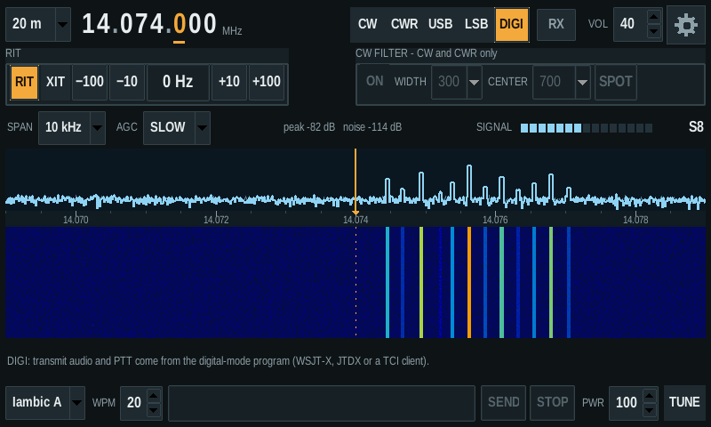
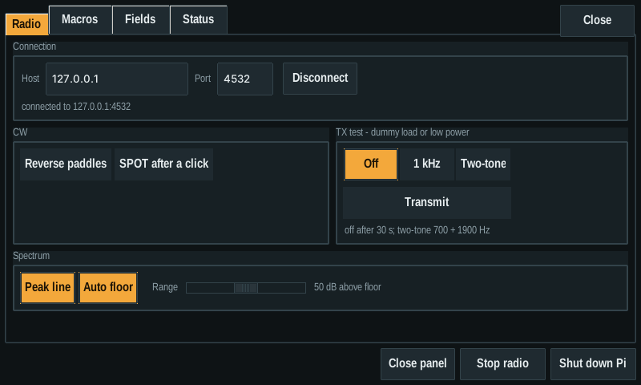
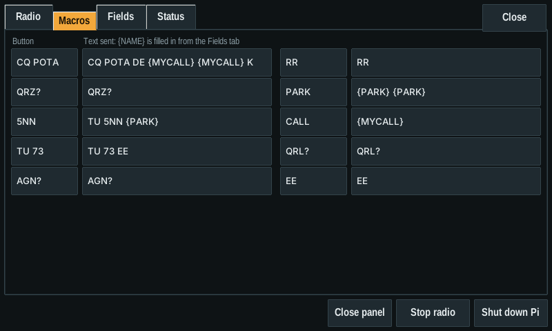
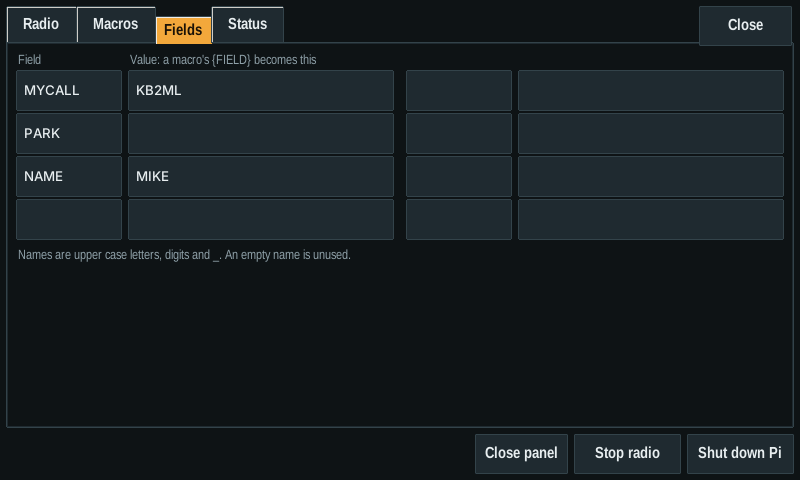
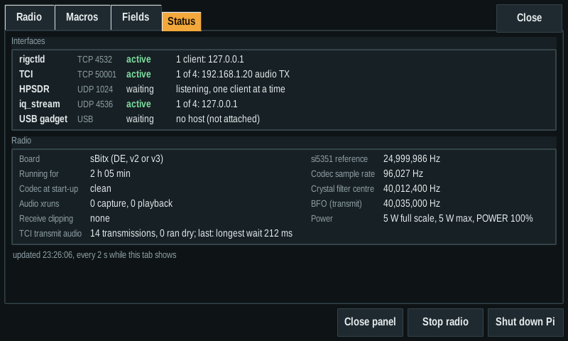

# 01 — user manual

**Status: outline.** Each section has a line or two on what it will say.
The full text follows once the outline is settled. Marks:
*(to check)* - needs a test on the radio or on air before it's written up;
*(new)* - nothing written about it yet anywhere in the repository.

This manual is for operating maxibitx: getting it running, using the
control panel, and working CW, SSB and the digital modes. It says what
to do and what you will see, not how it works inside; for that, each
section links to [`00_intro.md`](00_intro.md), and for writing software
against the radio, to [`06_api.md`](06_api.md).

The screenshots are from the panel at the sBitx screen's 800×480,
connected to a simulated radio, so the band activity is made up.

---

## 1. Before you start

- What you need: an sBitx (DE, v2 or v3) or a zBitx, its Pi, a key,
  paddles or the mic, an antenna, and a dummy load for the first
  transmit.
- What maxibitx is in one paragraph: the radio runs without a screen of
  its own; the panel, SDR programs and WSJT-X are its front panels, on
  the Pi or across the network.
- Which front panel to use for what: a one-line table (the panel, WSJT-X
  or JTDX, SparkSDR or SDR Console, sdrOxide, FLRig, a logger).

## 2. Installing

- Prepare the Pi: the codec overlay, the I2C bus, the `gpio` group, the
  packages (from the README and [`08`](08_troubleshooting_and_bringup.md)).
  A zBitx also needs the UART off.
- Get the code, `make`, and `make test` to confirm the build.
- Make your `data/hw_settings.ini` from `hw_settings_sbitx.ini` or
  `hw_settings_zbitx.ini`, and set the board line.
- Updating later: `./update`, then `make`.
- The USB gadget, only if you want single-cable USB audio and CAT: a
  pointer to `usb_gadget_OS_setup.md`.

## 3. Starting and stopping

### Starting maxibitx from a console

- Open a terminal on the Pi (or SSH in), `cd` to the repository
  folder, and run `./maxibitx`. It has to start there, where it finds
  `data/hw_settings.ini`.
- What the console prints when all is well: the board it found, the
  codec check, the interfaces that came up, and the ready line,
  `maxiBitx: radio hardware initialization complete, ready to serve!`
  A sample start-up, line by line.
- What it prints afterwards while you operate: one line for each thing
  that happens to the radio (tuning settled, mode, PTT), not for every
  request a program makes.
- Leave the terminal open while you operate: closing it, or an SSH
  session dropping, stops maxibitx, cleanly, as Ctrl-C does.

### Starting the control panel

- On the Pi's own screen: in a second terminal,
  `python3 tools/rigctl_panel.py`. On the sBitx's 800×480 screen it
  opens full screen; F11 switches to a window and back, Escape leaves
  full screen.
- On another computer: copy `tools/rigctl_panel.py`, install Python 3
  with tkinter and numpy, and run it with `--host` and the Pi's name or
  address. It remembers the last host.
- Start them in either order: the panel keeps trying to connect every
  5 s, and reconnects by itself when maxibitx restarts.

### Starting at boot *(placeholder - for later)*

- A systemd unit for maxibitx, so it starts with the Pi and restarts
  if it stops.
- A desktop autostart entry for the panel on the Pi's screen.
- To be written and tested before this section is filled in.

### Stopping

- Stop radio or Shut down Pi along the bottom of the panel's Settings
  (each wants a second tap), or Ctrl-C at the console.
- Why the clean stop matters: PTT and the T/R relays are dropped
  first, before anything else stops.

## 4. The control panel

- A tour of the main screen, top to bottom, one short paragraph per
  row: band, frequency, mode, RX/TX, VOL, the gear; RIT/XIT; CW FILTER
  and SPOT; span, AGC and the signal meter; the spectrum and waterfall;
  the decoded CW; the mode's own row; the bottom row.
- Tuning: tap a digit, then the wheel, a drag or the keys; double-click
  to type a frequency; click to tune on the spectrum; the band menu's
  memory; the sBitx's two knobs.
- Reading the spectrum: the noise floor, Range, the peak line, what
  span to use for what.
- The number boxes (VOL, PWR, WPM, MIC): arrows, typing, Return.
- Settings, from the gear: what's there, in one line, with a pointer
  to the reference section for each tab.

## 5. Operating CW

- Plugging in: paddles (tip dot, ring dash) or a straight key; the
  mono-plug message; reversing the paddles.
- Keyer type and speed; sending from the text box; Stop.
- Macros for a typical exchange, with two complete sets to type into
  Settings → Macros and Fields *(to check on air)*:

  **A POTA activation.** Fields: MYCALL, PARK (the park reference),
  STATE.

  | Button | Sends |
  |---|---|
  | CQ POTA | `CQ POTA CQ POTA DE {MYCALL} {MYCALL} K` |
  | QRZ? | `QRZ?` |
  | 5NN | `TU UR 5NN 5NN {STATE} {STATE} BK` |
  | AGN? | `AGN?` |
  | RR | `RR` |
  | TU 72 | `TU 72 {MYCALL} POTA` |
  | PARK | `{PARK} {PARK}` |
  | CALL | `{MYCALL}` |
  | QRL? | `QRL?` |
  | EE | `EE` |

  **A CW contest** with a fixed exchange (a zone, state or power;
  serial numbers aren't supported - the panel has no counter). Fields:
  MYCALL, EXCH.

  | Button | Sends |
  |---|---|
  | CQ TEST | `CQ TEST {MYCALL} {MYCALL} TEST` |
  | EXCH | `5NN {EXCH}` |
  | TU | `TU {MYCALL}` |
  | CALL | `{MYCALL}` |
  | MY EXCH | `TU 5NN {EXCH}` (answering a CQ) |
  | AGN? | `AGN?` |
  | NR? | `NR?` |
  | CALL? | `CL?` |
  | EXCH x2 | `{EXCH} {EXCH}` |
  | QRL? | `QRL?` |

  How to use each in a run and in search and pounce.
- Finding and answering a station: the CW filter's width and centre,
  SPOT, RIT and XIT, and when to use each.
- The decoder: what it copies well, what it doesn't (very slow or
  ragged sending, QRM), clearing it.
- Break-in: semi-QSK with a hang time; what you hear between your
  overs.
- AGC for CW.

## 6. Operating SSB

- Mic, PTT on the key jack's ring, USB or LSB by band.
- Setting mic gain with the ALC meter: speech peaks a couple of dB.
- Power and the meter you have: why an average-reading wattmeter shows
  less on voice than on a carrier.
- What you hear while transmitting (nothing from the mic; the sidetone
  and test tones follow VOL).

## 7. Digital modes

- DIGI mode: what it does to the radio (audio and PTT from the program,
  key jack ignored).
- Three ways to connect, with tested settings for each:
  - **WSJT-X or JTDX over USB** - audio device, CAT as TS-480, PTT CAT
    (from [`06_api.md`](06_api.md), "Using it with WSJT-X").
  - **JTDX or WSJT-X Improved over TCI** - one network connection for
    control and audio *(to check: exact settings screens)*.
  - **rigctld** for rig control with another audio path *(to check)*.
- Setting the transmit level: the program's output level against the
  ALC meter.
- FT8 on two computers' clocks: time sync *(new)*.

## 8. SDR programs and remote operation

- SparkSDR and SDR Console over HPSDR: what works (I/Q, tuning, MOX),
  what doesn't (their audio out to the radio), tune from the app while
  it's connected.
- sdrOxide over TCI as a panadapter.
- FLRig and loggers: which interface to point them at.
- Remote operation over the network: the panel from another computer;
  what to expect over Wi-Fi *(to check)*; the radio has no password, so
  keep it on your own network.

## 9. Setting up your radio

- Frequency: setting `cal` and `codec_rate` from WWV, step by step.
- Power: calibrating each band's `scale` with a dummy load and a
  wattmeter; `full_scale_power` and `max_power`; what a tuner's meter
  reads.
- An external amplifier: `ext_ptt_delay_ms`.
- The key: `key_debounce_ms`.
- TCI: port, clients and which network.

## 10. Reference

- Modes: what each one receives, transmits, and takes PTT from.
- Every `hw_settings.ini` line: what it does, its default and range.
- Console messages an operator may see, what each means, and whether to
  act - drawn from 08's "What the console shows".
- Keyboard and mouse shortcuts in the panel (F11, Escape, the digit
  keys).

### The Settings tabs

- **Radio:** the connection, paddle reversal, SPOT after a click, the
  test tones, the spectrum's options.

- **Macros:** a button label and the text it sends, ten of them;
  `{MYCALL}` and the other fields; why a macro with an empty field
  isn't sent. Example sets are in §5.

- **Fields:** eight in all, MYCALL and PARK to start with; the allowed
  names.

- **Status:** what each interface line and radio line means, and which
  ones to act on.
- The bottom row: Close panel, Stop radio, Shut down Pi, and the second
  tap they want.

## 11. When something's wrong

- A symptom table, each row pointing to the fix or to 08 for the depth:
  no audio; nothing on the spectrum; "PTT refused"; no power or low
  power; wrong sideband; a spectrum full of ghosts; a program can't
  connect; the panel says not connected; the panel doesn't fit the
  screen.

## 12. What it doesn't do (yet)

- No AM or FM; no split, memories or a second VFO; no SWR or power
  readout; no transmit timeout for a remote client that disappears;
  relay break-in rather than full QSK; no calibrated S-meter.
- Each with a line on what to do instead, where there is something.
