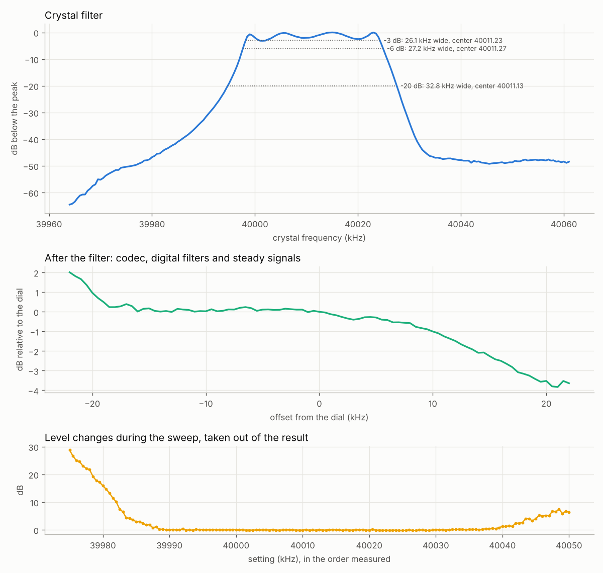
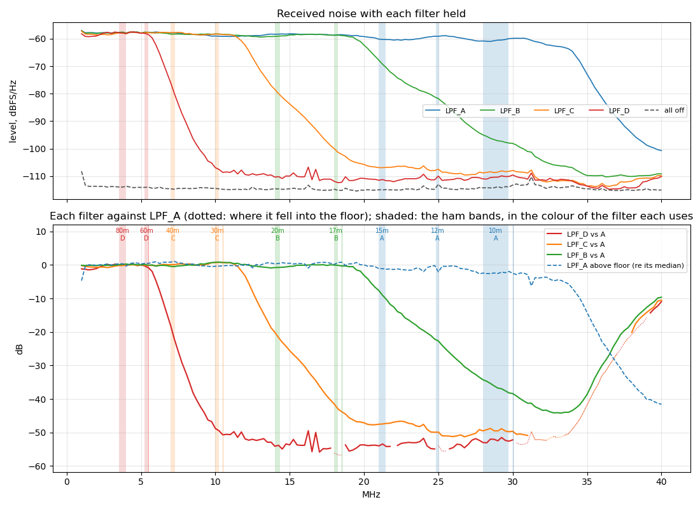

# sBitx crystal filter and low-pass filters, measured

Status: measured 22 November 2026 on Mike's sBitx (DE board), with a
broadband noise source at the antenna jack, using `tools/xtal_sweep.py`
and `tools/lpf_sweep.py`. The crystal filter figures are exact, from the
sweep's fit. The low-pass filter figures in §3 are read from the plot to
about a dB and a tenth of a MHz; the sweep's own printed report has the
exact values.

## 1. In brief

- **Crystal filter:**
    - 27.2 kHz wide at −6 dB and 32.8 kHz at −20 dB, a shape factor of 1.2;
    - about 3 dB of ripple across the top, in four bumps;
    - more than 45 dB down 20 kHz outside the passband.
- **The receiver's setting:** its −6 dB centre is 40,011,300 Hz (to 100 Hz).
  `data/hw_settings_sbitx.ini` has `xtal_filter_center=40012400`, 1.1 kHz
  above it (§2.4), taken from a different filter's sweep (§2.6).
- **Low-pass filters:** every band sits in its filter's flat passband, within
  about 1 dB. Third harmonics are 45–50 dB down where measured. The weakest
  points are the second harmonics of 80 m (15–29 dB) and 40 m (19–23 dB)
  from the filter alone, which leaves the transmitter's even-harmonic
  suppression to the power amplifier (§3.3).

## 2. The 40 MHz crystal filter



### 2.1 How it was measured

`xtal_sweep.py` held the dial still and stepped `xtal_filter_center` from
39,975,000 to 40,050,000 Hz in 500 Hz steps, 151 settings, recording the
I/Q spectrum at each. Each offset d from the dial sees the crystal filter
at `xtal_filter_center − d`. A fit separates three things:

- the filter;
- the response after it (the codec and its digital filters);
- level changes from step to step.

Each crystal frequency is seen at up to 89 offsets.

The noise source gave 57 dB of depth, from the passband to the 5th
percentile of the result: the deepest this measurement can see.

### 2.2 Passband and skirts

| Level | Low edge (Hz) | High edge (Hz) | Width | Centre (Hz) |
| --- | --- | --- | --- | --- |
| −3 dB | 39,998,201 | 40,024,263 | 26.1 kHz | 40,011,232 |
| −6 dB | 39,997,661 | 40,024,888 | 27.2 kHz | 40,011,275 |
| −20 dB | 39,994,715 | 40,027,539 | 32.8 kHz | 40,011,127 |

The top has four peaks within 0.7 dB of each other, with troughs between
them 2 to 3 dB down:

| | Crystal frequency (kHz) | dB below the highest peak |
| --- | --- | --- |
| peak | 39,999.0 | 0.7 |
| trough | 40,001.5 | 3.1 |
| peak | 40,005.5 | 0.2 |
| trough | 40,010.0 | 2.0 |
| peak | 40,015.0 | 0.0 |
| trough | 40,020.0 | 2.5 |
| peak | 40,023.0 | 0.0 |

The skirts are steep and nearly symmetric to −20 dB. Further out the low
side keeps falling: −33 dB at 39,990 kHz, −47 dB at 39,980 kHz and −55 dB
at 39,970 kHz. The high side reaches −34 dB at 40,030 kHz and −47 dB at
40,035 kHz, then levels off at −48 to −49 dB from 40,040 kHz on.

### 2.3 After the filter

The codec and its digital filters are flat within 0.3 dB from −18 to
+6 kHz from the dial. They fall to −3.6 dB at +22 kHz, near the top of the
codec's band, and rise 2 dB at −22 kHz, near its bottom.

### 2.4 The setting, and what the ripple means for reception

`xtal_filter_center` is the crystal frequency the dial sits on, so it
sets where the panadapter's span falls in the passband. The −6 dB centre,
40,011,300 Hz, puts the span symmetrically in it.

The example file's 40,012,400 Hz is 1.1 kHz high, which costs about 1 kHz
of flat passband on one side of the display. The transmit IF is also
derived from `xtal_filter_center` (`tx_pipeline_set_if_placement()`), so
after changing it, check once that a CW carrier still lands on the dial.

At 40,011,300 the dial sits 1.7 dB below the nearest peak, at 40,015,000.
That ripple doesn't change the signal-to-noise ratio of a signal heard
through it. The filter attenuates the signal and the band noise at that
frequency alike, so the peak only helps against noise added after the
filter. That matters only on a band where the antenna's noise is not well
above the receiver's own. On most bands below about 20 MHz it is well
above, and the dial's place in the ripple makes no difference to
copyability.

### 2.5 The second mixer's image, seen in passing

The sweep's level changes, its bottom panel, are flat apart from the
first and last 10 to 20 settings, which sit 7 to 29 dB higher. At the
start of the sweep the second oscillator, clk1, 24 kHz above the setting,
sits just below the passband. The second mixer then hears the whole
passband through its image, raising every offset at once. At the end,
the same comes back as an alias from above the codec's band.

At the normal setting the image of the passband falls at 40,045 to
40,073 kHz, where the filter is 48 to 49 dB down. That is the receiver's
image rejection for the second mixer.

The fit's straight-line trend is fitted only to the settings that agree
with it (`robust_line()` in `xtal_sweep.py`), so these settings don't
tilt the result. Before that change, they tilted the filter by about
0.2 dB per kHz and made its two ends look 2 dB apart.

### 2.6 Compared with the earlier data

`antialias_filter_design.md` §2 used a network analyzer sweep from Evan
AC9TU, of a filter that may not be the sBitx's. The example file's
`xtal_filter_center=40012400` came from it. This filter differs:

| | AC9TU's sweep | This sBitx |
| --- | --- | --- |
| Centre | 40,012.4 kHz | 40,011.3 kHz (−6 dB) |
| −3 dB width | 34.8 kHz | 26.1 kHz |
| About 29 kHz above the centre | −61 dB at 40,040.9 kHz | −48 dB at 40,040 kHz |

The narrower passband only helps the anti-alias filter's case: less of
the crystal filter's output reaches the codec's band edges. The shallower
far skirt above 40,040 kHz is where the second mixer's image lands (§2.5),
so this sBitx's image rejection is about 48 dB, not 60. It may be the
filter's own, or a path around it; this measurement can't tell which.

## 3. The low-pass filters



### 3.1 How it was measured

`lpf_sweep.py` stepped the dial from 1 to 40 MHz in 250 kHz steps. At each
frequency it held LPF_A, B, C and D in turn, then every relay open, and
measured the noise 1 to 10 kHz either side of the dial. Each filter is
reported against LPF_A, which is flat to about 30 MHz, so the noise
source's and the receiver's own slopes cancel.

With every relay open the level fell about 55 dB, to −114 dBFS/Hz. That
floor sets how deep the stopbands can be seen. A dotted line on the plot
marks where a filter fell into it.

### 3.2 Passbands and cutoffs

| Filter | Radio selects it below | Bands | Flat to | −3 dB, about |
| --- | --- | --- | --- | --- |
| LPF_D | 5.5 MHz | 80 m, 60 m | 5.3 MHz | 6.0 MHz |
| LPF_C | 10.5 MHz | 40 m, 30 m | 11 MHz | 12.3 MHz |
| LPF_B | 18.5 MHz | 20 m, 17 m | 18 MHz | 20 MHz |
| LPF_A | 30 MHz | 15 m, 12 m, 10 m | 34 MHz | 35 MHz |

Every band lies in its filter's flat passband, within about 1 dB of LPF_A.
The closest to a knee are 60 m on LPF_D and 17 m on LPF_B, each losing
under 1 dB.

### 3.3 Harmonic attenuation, from the filter alone

| Band | Filter | 2nd harmonic | Attenuation | 3rd harmonic | Attenuation |
| --- | --- | --- | --- | --- | --- |
| 80 m | D | 7.0–8.0 MHz | about 15–29 dB | 10.5–12.0 MHz | about 50 dB |
| 60 m | D | 10.7–10.8 MHz | about 50 dB | 16.0–16.2 MHz | about 53 dB |
| 40 m | C | 14.0–14.6 MHz | about 19–23 dB | 21.0–21.9 MHz | about 47 dB |
| 30 m | C | 20.2–20.3 MHz | about 32 dB | 30.3–30.5 MHz | about 50 dB |
| 20 m | B | 28.0–28.7 MHz | about 33–35 dB | above 40 MHz | not measured |
| 17 m | B | 36.1–36.3 MHz | 50 dB or more | above 40 MHz | not measured |

The harmonics of 15, 12 and 10 m are above 40 MHz, outside the sweep.

Below 30 MHz, US rules (§97.307(d)) ask for spurious emissions at least
43 dB below the carrier. The 80 m and 40 m second harmonics get less than
that from the filter alone. A push-pull power amplifier, as the sBitx
uses, suppresses even harmonics before the filter. The radio's actual
figure is the two together, and only a transmit measurement shows it: the
bottom of 80 m and 40 m into a dummy load, through an attenuator into a
spectrum analyzer or a second receiver.

### 3.4 Reading the plot above 30 MHz

Every curve in the lower panel is relative to LPF_A, and above about
34 MHz LPF_A itself is rolling off. LPF_B's and LPF_C's curves rising
there is A falling, not B or C passing more. In the upper panel both stay
a few dB above the floor, so their real attenuation there is about 50 dB
or more.

## 4. Repeating the measurements

With a noise source at the antenna jack, nothing that can transmit
connected, and its level checked: switching it on should raise the floor
40 dB or more, and 10 dB of attenuation should lower it by 10 dB.

```
python3 tools/xtal_sweep.py --dial 14100000 --step 500
python3 tools/lpf_sweep.py --passes 2
```

`--refit` and `--replot` redraw a run from its `_raw.csv` without the
radio. `tools/README.md` describes both tools; `zbitx_port_study.md` §11
explains the crystal filter fit.

## 5. Open

- The transmitted harmonics on 80 m and 40 m (§3.3).
- Whether to change the example file's `xtal_filter_center` to 40,011,300
  (§2.4).
- The exact low-pass filter figures, from the LPF sweep's printed report.
